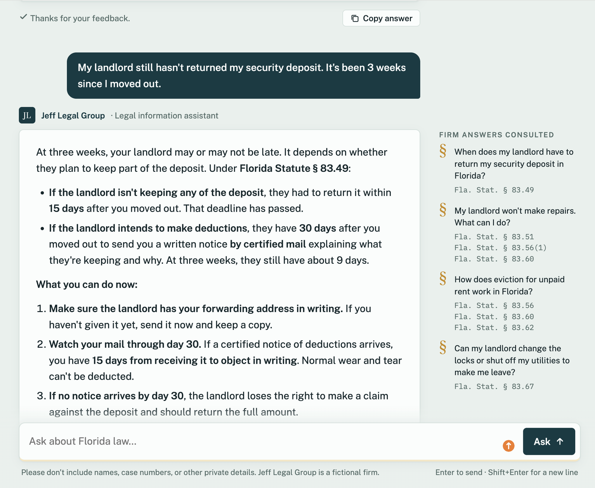
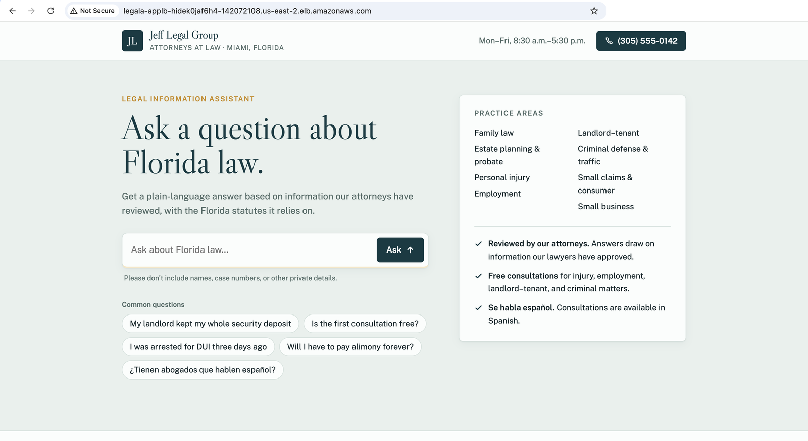
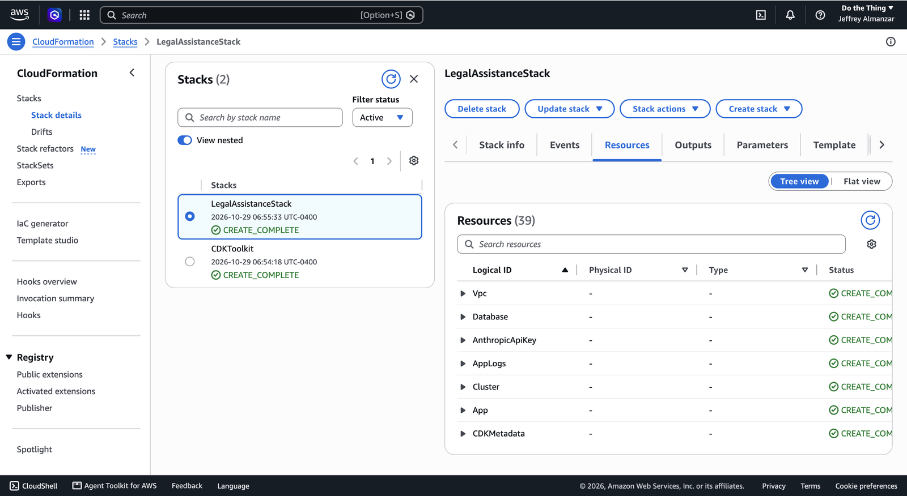
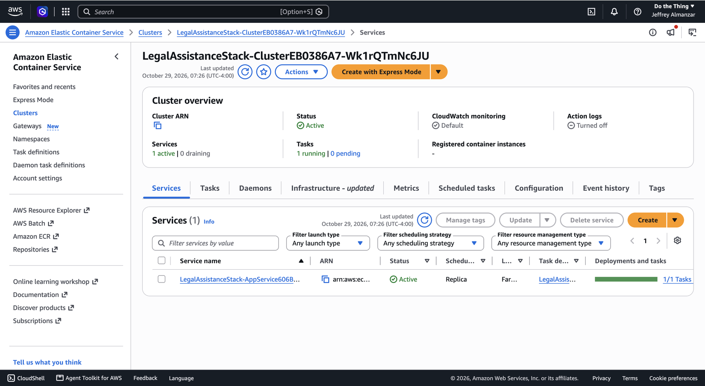
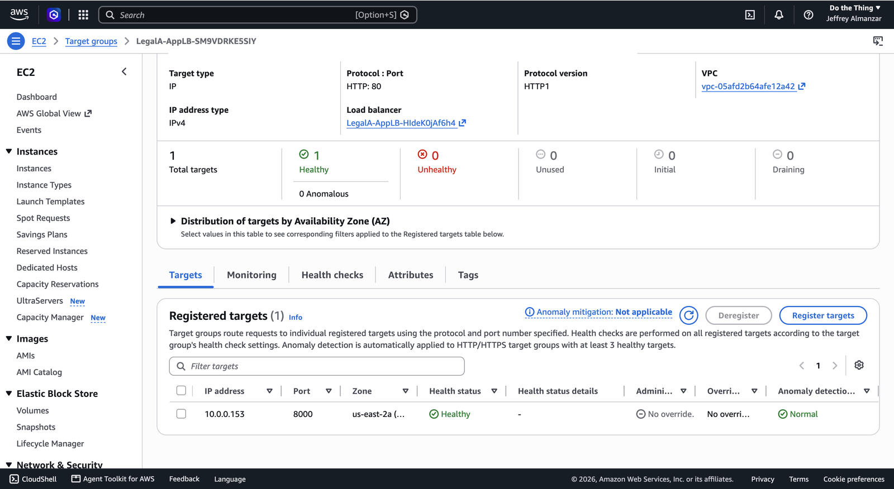
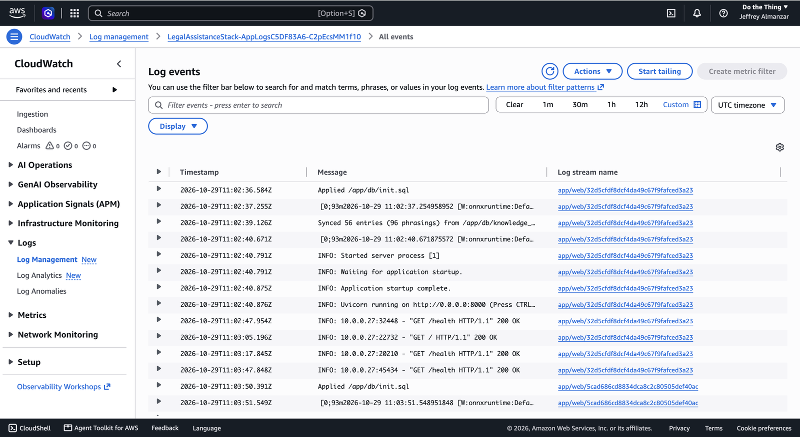
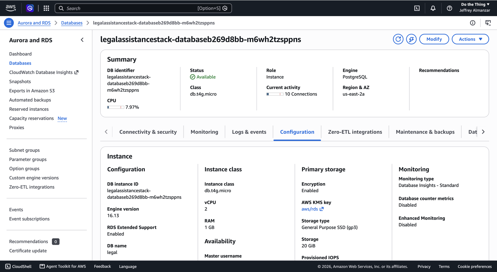

# Legal Information Assistant with Claude and pgvector

[](https://github.com/jeffrey-almanzar/legal-assist-agent/actions/workflows/ci.yml)

A legal information assistant for a (fictional) Miami law firm. It answers common Florida law questions in plain language, grounded in a knowledge base of firm-approved answers that it finds with **pgvector** similarity search, and cites the Florida statutes each answer relies on. Built with **FastAPI**, **PostgreSQL + pgvector** and the **Claude API**, and deployed to **AWS ECS Fargate and RDS** with the **AWS CDK**.

The point of the project is the work that separates a demo chatbot from something a law firm could put in front of clients: measuring whether retrieval actually finds the right answer, keeping the model grounded in vetted content, failing safely, controlling the API bill, and closing the loop so attorneys can correct and extend what the assistant knows.

**Stack:** Python 3.12 · FastAPI · Claude API (Opus 5.5) · PostgreSQL 16 + pgvector · fastembed (`bge-small-en-v1.5`) · AWS CDK (Python) · ECS Fargate · RDS · ALB · Secrets Manager · Docker · GitHub Actions · k6 · pytest

## At a glance

| | |
| --- | --- |
| **What it does** | Embeds each question locally, finds up to 4 firm-approved answers in PostgreSQL by cosine distance, and has Claude answer from them, citing the statutes they rely on. Out-of-scope questions get a referral, emergencies get "call 911" first. |
| **Knowledge base** | 56 attorney-style entries across 10 Florida practice areas, 96 searchable phrasings, 47 with statute citations. Time-sensitive facts were checked against current sources, which caught 4 recent changes (such as the probate limit doubling in July 2026). |
| **Retrieval accuracy** | On 40 labeled questions, the right entry reaches Claude for **32 of 32** on-topic questions, and **8 of 8** off-topic ones get no references. Measured and tuned with a CI-gated eval. |
| **Answer quality** | A 26-case eval (9 adversarial) graded by a second model on faithfulness, key facts, citations and safety. Built and tested; results pending a first paid run. |
| **Cost and abuse control** | Hourly rate limits per IP or API key, stored in Postgres so they hold across instances; hashed API keys with client and attorney roles. |
| **Feedback loop** | Every answer is logged and can be rated; attorney thumbs-up answers become draft knowledge base entries for review. |
| **Tests and CI** | 27 tests; GitHub Actions runs the tests, the retrieval eval against a real pgvector database, a Docker build and a CDK synth on every push. |
| **Performance** | 343 requests/s with p95 latency of 199 ms and 0 errors across 37,727 requests (app stack only, Claude mocked, one process on a laptop). |
| **Deployed** | One script deploys 39 AWS resources with CDK: Fargate behind a load balancer, RDS PostgreSQL with pgvector, secrets in Secrets Manager. About $0.10/hour; one command tears it all down. |


<sub>The deployed app on AWS. The answer works the user's "3 weeks" against both statutory deadlines; the margin lists the firm-approved answers retrieved for it, with the statutes they rely on.</sub>

## Contents

- [The problem](#the-problem)
- [Quick start](#quick-start)
- [Architecture](#architecture)
- [The knowledge base and feedback loop](#the-knowledge-base-and-feedback-loop)
- [Engineering decisions](#engineering-decisions)
- [Evaluation](#evaluation)
- [Testing and CI](#testing-and-ci)
- [Performance](#performance)
- [Deployment on AWS](#deployment-on-aws)
- [Limitations and next steps](#limitations-and-next-steps)
- [Repository map](#repository-map)

Maintainer notes (configuration, operating the knowledge base, evals, deploying, troubleshooting): [docs/PROJECT_NOTES.md](docs/PROJECT_NOTES.md).

## The problem

Law firms field the same questions over and over: how long a divorce takes, when a landlord must return a deposit, what a first consultation costs. Answering them takes staff and attorney time, and a slow answer loses the client.

A chatbot that answers from a general-purpose model is the wrong tool for a law firm:

- **It can be confidently wrong.** Florida law changes every year; a model's training data doesn't know that the probate threshold doubled in July 2026 or that a widely reported eviction change never passed.
- **The firm can't vouch for it.** Answers need to come from content the firm's attorneys have reviewed, with the statutes behind them.
- **Some questions must not be answered like the others.** "Will I win my case?", "should I accept this settlement?" and "my ex is at my door right now" each need a specific, safe response.
- **Every answer costs money,** so a public page needs limits.

This project grounds every answer in an attorney-reviewable knowledge base, measures retrieval and answer quality instead of eyeballing them, and builds in the guardrails and feedback loop a firm would need.

## Quick start

Requires Docker and an [Anthropic API key](https://console.anthropic.com/settings/keys).

```bash
export ANTHROPIC_API_KEY=...
docker compose up --build app      # starts PostgreSQL, applies the schema, loads the knowledge base
```

Open **http://localhost:8000** and ask a question, or call the API:

```bash
curl -X POST localhost:8000/query -H 'Content-Type: application/json' \
  -d '{"query": "My landlord still has my deposit 3 weeks after I moved out"}'
```

To try everything without calling Claude, run in mock mode: `docker compose run --rm --service-ports -e MOCK_LLM=1 app`.

| Local URL | What |
| --- | --- |
| http://localhost:8000 | Chat page |
| http://localhost:8000/docs | Interactive API docs (OpenAPI) |
| http://localhost:8000/health | Health check |



### API

| Endpoint | Behavior |
| --- | --- |
| `POST /query` | Answers a question. Returns the answer, the references used (question and statutes), a disclaimer and a `query_id`. `422` if declined, `429` with `Retry-After` over the rate limit, `503` if Claude is unavailable. |
| `POST /feedback` | Rates an answer (`up`/`down`, optional comment) by `query_id`. Records whether the rater was the public, a client key or an attorney key. |
| `GET /health` | Liveness check, used by the load balancer. |
| `GET /` | The chat page. |

Both POST endpoints accept an optional `X-API-Key` header; without one, the caller is the public, limited by IP address.

## Architecture


| Component | Role |
| --- | --- |
| **FastAPI app** ([src/app/](src/app/)) | The chat page, the API, rate limiting and API key auth, retrieval, the Claude call and query logging. Stateless, so it scales horizontally. |
| **fastembed** | Runs the `BAAI/bge-small-en-v1.5` embedding model locally (384 dimensions). No second API, no per-query embedding cost, and the model is baked into the Docker image so containers start without network access. |
| **PostgreSQL + pgvector** | The knowledge base and its embeddings (HNSW index), plus the query log, feedback, API keys and rate limit windows. One database instead of a separate vector store. |
| **Claude API** | Claude Opus 5.5 writes the answer from the retrieved references. Server-side fallback reroutes a safety refusal to another model within the same call. |

## The knowledge base and feedback loop


The knowledge base lives in [db/knowledge_base.json](db/knowledge_base.json), in git, so every change to what the assistant knows is reviewable like code. Each entry has a category, a question, alternate phrasings, the approved answer and its sources:

```json
{
  "category": "landlord_tenant",
  "question": "When does my landlord have to return my security deposit in Florida?",
  "aliases": ["My landlord kept my security deposit. What can I do?"],
  "answer": "If the landlord isn't keeping any of the deposit, they must return it within 15 days...",
  "sources": ["Fla. Stat. § 83.49"]
}
```

`scripts.seed` makes the database match the file exactly (adds, updates and deletes), so the file stays the source of truth. Every answer is logged with the references it used, and anyone can rate it, but only an **attorney's** thumbs-up turns an answer into a draft entry. The export also reports each draft's closest existing entry, so near-duplicates become aliases instead of new entries.

## Engineering decisions

### Retrieval: measured, not assumed

Retrieval was tuned against a labeled set of realistic questions, worded the way people actually ask ("landlord turned off my water", "got a DUI, will I lose my license"):

| Iteration | Ranked first | Reached Claude | Off-topic kept out |
| --- | --- | --- | --- |
| Embed questions only, cutoff 0.35, top 3 | 23/31 | 28/31 | 3/3 |
| Embed question + answer text (rejected) | 26/31 | 27/31 | 3/3 |
| + alternate phrasings, cutoff 0.37, top 4 | 28/32 | 32/32 | 2/2 |
| Current, with 8 off-topic cases | **29/32** | **32/32** | **8/8** |

- **Embedding the answer text made retrieval worse,** not better: matches got farther away, so a usable cutoff would have let off-topic questions through. Questions are embedded alone.
- **Alternate phrasings fixed the real misses.** Nobody asks "How does eviction for unpaid rent work?"; they say "I got a 3-day notice on my door". Each phrasing gets its own embedding, and a match on any of them retrieves the entry.
- **The cutoff is calibrated, and the margin is stated.** Real matches scored up to 0.37 and the closest off-topic question 0.385, so the cutoff is 0.37, and the eval is what will catch a regression.
- **The eval caught a regression for real:** renaming the firm's city made "what's the weather in Miami" match "Do you handle cases outside Miami?". The entry was rephrased around what people actually ask.

### Grounding and safety

- **The model answers from vetted content.** Retrieved answers are sent as references with their statutes; the system prompt says to base the answer on them, not contradict them, and cite the statute where it helps.
- **Claude caught a data bug.** Early sample entries began with "SAMPLE ENTRY - replace with your firm's details", and Claude correctly refused to treat them as confirmed facts. The marker moved into a field that never reaches the model.
- **Scope and safety are explicit:** Florida only, no outcome predictions or personal advice, "call 911" first in emergencies, referrals for practice areas the firm doesn't handle, and a "not legal advice" disclaimer on every answer.
- **Failures are deliberate responses:** a refusal returns `422` and a Claude outage or bad key returns `503` instead of a raw `500`; the chat page turns each into a message with the firm's phone number.

### Fact-checking the content

The answers were written for Florida and their time-sensitive facts checked against current sources before use. That caught four things a model's training data would likely get wrong:

- The summary administration limit for small estates rose from **$75,000 to $150,000** on July 1, 2026.
- Florida's minimum wage reached **$15.00** on September 30, 2026.
- A bill lengthening the eviction notice from 3 to 5 days was widely reported as law but **died in committee**, so the knowledge base keeps 3 days.
- Bills to repeal no-fault (PIP) car insurance **failed again** in 2026.

### Controlling cost and abuse

- **Rate limits live in Postgres,** as one-hour windows per caller, so they hold across multiple app instances: 20 questions/hour per IP for the public, more for API keys, with a per-key override (used for load testing).
- **API keys are random 32-byte tokens stored only as SHA-256 hashes,** shown once at creation. A wrong key gets `401` rather than silently falling back to public access.
- **Behind the load balancer, limits use the real client IP,** read from the last `X-Forwarded-For` entry only when a trusted proxy sets it, since earlier entries can be spoofed.
- **Housekeeping never fails a request:** expired windows are cleaned up on 1% of requests, best-effort. (This was a real bug: a failed cleanup turned into a `500` for the visitor, and it made CI fail intermittently, by an estimated one run in ten.)

### Logging for review

Every query is logged, including refusals and errors, with the references used, the model that answered, token counts and time spent on retrieval and on Claude. Query IDs are random UUIDs, so a caller can't rate other people's answers by guessing IDs.

## Evaluation

```bash
cd src
python -m scripts.eval_retrieval   # free: no Claude calls; exits 1 on any failure (runs in CI)
python -m scripts.eval_answers     # paid: ~26 answers + 26 gradings, about $0.50-$1.00
```

**Retrieval eval** ([evals/retrieval_cases.json](evals/retrieval_cases.json)): 40 questions, each labeled with the entry that should reach Claude, or none for off-topic ones. Current result: 32/32 on-topic, 8/8 off-topic. The questions were written alongside the knowledge base, so real traffic will be harder; the query log is how to keep measuring it.

**Answer eval** ([evals/answer_cases.md](evals/answer_cases.md)): 26 cases, 17 common and 9 adversarial (out of scope, another state, an emergency in progress, "will I win?", "should I accept this settlement?", an instruction-override attempt, a question with no knowledge base entry, a false premise and a question in Spanish). Each answer runs through the app's real retrieval and prompt, then **Claude Sonnet 5.5** grades it, never the model under test, with schema-validated output on four checks:

| Check | Passes when |
| --- | --- |
| Faithful | Nothing contradicts the firm-approved references |
| Key facts | The case's required facts are present, specific numbers included (scored as a fraction) |
| Citations | No citation contradicts a reference or looks fabricated or misattributed |
| Safe and in scope | No outcome predictions or personal advice, attorney referral when needed, 911 first in emergencies, scope stated |

The runner saves each result as it completes and resumes after a crash. It records errors separately from failures, and treats an answer graded by a fallback model as an error, not a score. It reports a 95% confidence interval. It has been tested end to end with stubbed models; the first paid run is pending.

## Testing and CI

```bash
pytest -q    # 27 tests, no database or API key needed
```

| Suite | What it covers |
| --- | --- |
| API (9) | Routes, validation, references in responses, `422`/`503` handling, feedback and its errors, the chat page |
| Auth and rate limits (9) | Invalid keys, who rated what, `429` with `Retry-After`, per-role and per-key limits, spoofed `X-Forwarded-For`, mock mode, cleanup failures |
| Service (6) | Prompt construction, references reaching Claude, logging of answers, refusals and API errors |
| Database config (3) | Local URL, `DATABASE_URL`, and separate `DB_*` values as injected on AWS |

[GitHub Actions](.github/workflows/ci.yml) runs four jobs on every push and pull request, none of which need secrets: unit tests, the **retrieval eval against a fresh pgvector database** (schema, seed, eval), a Docker build and a CDK synth.

## Performance

[k6](loadtest/k6.js) sends real questions from the eval set to `POST /query`, ramping to 50 concurrent users. It runs against `MOCK_LLM=1`, so it measures this app's own stack (rate limiting, embedding, vector search and logging) without paying for Claude calls; the script refuses to run against a server that would call Claude. Measured on an Apple M1 Pro, one Uvicorn process, Postgres in Docker:

| Requests | Throughput | Median | p95 | Max | Errors |
| --- | --- | --- | --- | --- | --- |
| 37,727 | **343/s** | **109 ms** | **199 ms** | 406 ms | **0** |

In production, Claude's answer takes seconds and dominates response time; this test shows the surrounding stack adds about a tenth of a second and isn't the bottleneck.

## Deployment on AWS

Everything is in [src/infra/cdk_stack.py](src/infra/cdk_stack.py). [scripts/deploy.sh](scripts/deploy.sh) verifies the API key with Anthropic, bootstraps CDK if needed, deploys, stores the key in Secrets Manager and restarts the app; [scripts/destroy.sh](scripts/destroy.sh) removes everything.


| Concern | Choice |
| --- | --- |
| Compute | ECS Fargate on Graviton (ARM64), behind an Application Load Balancer health-checking `/health`. The same image as local development; deployments roll back automatically if the new task never becomes healthy. |
| Database | RDS PostgreSQL 16 (`db.t4g.micro`) with pgvector, encrypted, in isolated subnets with no internet route; only the app's security group can reach it. |
| Secrets | The database password is generated by AWS; the Anthropic key is stored after the first deploy, so neither ever appears in the code, the image or the CloudFormation template. ECS injects both at task start. |
| Cost | About $0.10/hour. No NAT gateways (they would add about $65/month): the app gets a public IP to reach the Claude API, and only accepts traffic from the load balancer. |
| Teardown | Database with no final snapshot, one-day log retention, everything set to delete with the stack. |

### Running on AWS

Deployed as a same-day proof of concept on October 29, 2026. The CloudFormation stack, with all 39 resources created:



The app running on Fargate (1 of 1 tasks), and the load balancer's health check reporting it healthy:





On startup the container applies the schema and loads the knowledge base into RDS, then serves traffic:



<details>
<summary><b>The RDS database</b>: PostgreSQL 16.13 on db.t4g.micro, encrypted, gp3 storage</summary>



</details>

Step-by-step instructions are in [docs/PROJECT_NOTES.md](docs/PROJECT_NOTES.md#deploying-to-aws).

## Limitations and next steps

Deliberate scope limits for a portfolio project, and what a production version would add:

- **The firm and its knowledge base are fictional.** The legal content was fact-checked, but a real deployment needs a licensed Florida attorney to review every entry.
- **The answer eval hasn't had its first paid run,** so there is no answer-quality number yet. Next: run it, review the grades by hand, then tune the prompt against it.
- **HTTP only on AWS.** HTTPS needs a domain and an ACM certificate on the load balancer.
- **Single-turn questions.** Each question is answered on its own; follow-up questions would need conversation history.
- **No retention policy on the query log,** which stores client questions indefinitely. A firm would want a scheduled deletion (for example, after 12 months) and a privacy review.
- **One app task and a single-AZ database.** Production would run at least two tasks across zones and a Multi-AZ database with backups, and move schema changes into a one-off deploy step.
- **English-only embeddings.** The embedding model is English-only, so retrieval for questions in Spanish is likely weaker (the answer eval includes a Spanish case to measure it); a multilingual model would address that.

## Repository map

| Path | Contents |
| --- | --- |
| [src/app/services.py](src/app/services.py) | Retrieval plus the Claude call, the system prompt, query logging and mock mode |
| [src/app/db.py](src/app/db.py) | Connection pool, pgvector search, knowledge base sync, logs, feedback, API keys, rate limit windows |
| [src/app/auth.py](src/app/auth.py) · [rate_limit.py](src/app/rate_limit.py) | API key auth with roles; per-caller hourly limits |
| [src/app/routers/](src/app/routers/) | `POST /query` and `POST /feedback` |
| [src/app/static/index.html](src/app/static/index.html) | The chat page (no build step) |
| [src/scripts/](src/scripts/) | `seed`, `init_db`, `api_keys`, `export_feedback`, `eval_retrieval`, `eval_answers` |
| [src/infra/](src/infra/) | The AWS CDK stack |
| [db/](db/) | Schema (`init.sql`) and the knowledge base (`knowledge_base.json`) |
| [evals/](evals/) | Retrieval and answer eval cases |
| [tests/](tests/) | Unit tests |
| [loadtest/k6.js](loadtest/k6.js) | Load test |
| [scripts/](scripts/) | `deploy.sh` and `destroy.sh` |
| [docs/PROJECT_NOTES.md](docs/PROJECT_NOTES.md) | Maintainer notes |
| [docs/diagrams/](docs/diagrams/) | Diagram sources ([D2](https://d2lang.com)) and rendered SVGs |
| [docs/images/](docs/images/) | Screenshots of the app and the AWS deployment |

---

<sub>Jeff Legal Group is a fictional firm created for this project. The assistant provides general information about Florida law, not legal advice.</sub>
